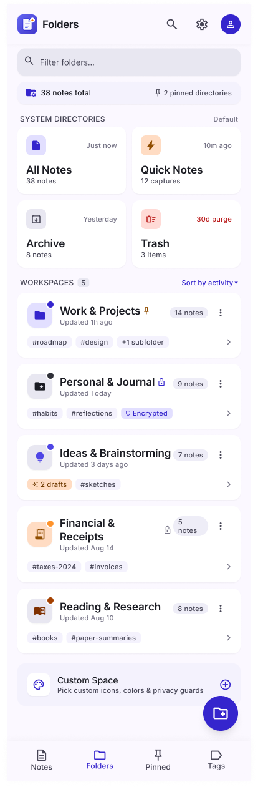
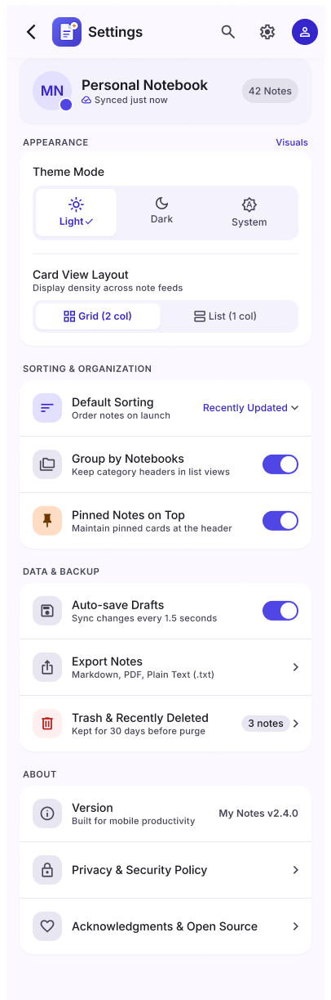

<p align="center">
  
</p>

<h1 align="center">My Notes</h1>

<p align="center">
  <em>Quiet thought &amp; clarity — a calm, modern notes app for Android.</em>
</p>

<p align="center">
  
  
  
  
  
</p>

---

## Overview

**My Notes** is a minimalist note-taking app built entirely with **Jetpack Compose** and **Material 3**. It focuses on a distraction-free writing experience: capture a thought with one tap, organize notes with pins, check off to-dos, and find anything instantly with search.

The interface follows a soft lavender visual language — rounded cards, gentle shadows, clear typography, and a vibrant indigo accent — designed in Figma and implemented pixel-by-pixel in Compose.

## Screenshots

### Home &amp; writing

| Home — My Notes | Empty state | Search |
|:---:|:---:|:---:|
|  |  |  |
| Pinned notes, recent notes, grid/list layout, and quick actions | A friendly first-run experience with note templates | Search across titles, content, and tags |

| Note editor | Assign note to folder |
|:---:|:---:|
|  |  |
| Title, rich-text toolbar, checklists, quick inserts, and character count | Move a note between workspaces and subfolders |

### Folders &amp; organization

| Folders overview | Folder details |
|:---:|:---:|
|  |  |
| System directories and custom workspaces with tags and note counts | Pinned notes, subfolders, and filtered views inside a workspace |

| Empty folder | Branding |
|:---:|:---:|
|  |  |
| A guided empty state for creating the first note in a folder | App icon and splash identity |

### Settings

<p align="center">
  
</p>

> Screenshots are the project's UI design reference (Figma) and live in the [`screenshots`](screenshots) folder.

## Features

### Working today

- **Notes feed** with a dedicated pinned section and an all-notes grid
- **Create a note instantly** with the floating action button
- **Note editor** for title, body, category, and pin state
- **Search** notes by title, body, or category as you type
- **Pin / unpin** important notes
- **Duplicate** a note with a single action
- **Delete with Undo** via a snackbar confirmation
- **Checklist support** with tappable items
- **Layout & sort controls** for the notes feed
- **Material 3 theming** with a custom lavender palette and typography
- **Bottom navigation** for Notes, Folders, Pinned, and Tags

### On the roadmap

- Persistent local storage (Room / DataStore)
- Full folder and workspace management, including subfolders
- Tags, filtering, and combined search filters
- Trash with automatic 30-day cleanup
- Settings: dark mode, auto-save, export (Markdown / PDF / plain text)
- Note templates and quick inserts
- Backup and restore

## Tech stack

| Area | Technology |
|---|---|
| Language | Kotlin 2.2.10 |
| UI | Jetpack Compose, Material 3, Compose BOM `2026.02.01` |
| Navigation | Navigation Compose with type-safe routes |
| Architecture | MVVM + unidirectional data flow (StateFlow, intents, effects) |
| Dependency injection | Hilt (Dagger) |
| Async | Kotlin Coroutines & Flow |
| Serialization | kotlinx.serialization |
| Build | Gradle 9.5, AGP 9.3.3, Kotlin DSL version catalog |
| SDK | `minSdk 24`, `targetSdk 37`, `compileSdk 37` |

## Architecture

The app follows a clean, layered MVVM structure:

```
UI (Compose)
   │  intents            ▲  state / one-shot effects
   ▼                     │
ViewModel (StateFlow)
   │
   ▼
Repository interface
   │
   ▼
Data source (in-memory StateFlow, Room planned)
```

- **Screens** are stateless and render a single immutable `ViewState`.
- **ViewModels** receive `Intent`s, update state, and emit one-shot `Effect`s (snackbars, navigation).
- **Repositories** expose `Flow` streams, keeping the UI reactive.
- **Hilt** wires repositories and view models together.

Key files:

| File | Responsibility |
|---|---|
| `MainActivity.kt` | App entry point, theme, navigation graph |
| `view/HomeScreen.kt` | Notes feed, search, pinned section, FAB |
| `view/NoteDetailScreen.kt` | Note editor and reading view |
| `view/viewmodel/NotesScreenViewModel.kt` | Feed state and note intents |
| `view/viewmodel/NoteViewModel.kt` | Editor state and save/update logic |
| `repository/NoteRepositoryImp.kt` | In-memory reactive note store |
| `model/Note.kt` | `Note`, `ChecklistItem`, and `Folder` models |

## Getting started

### Requirements

- Android Studio with Android SDK 37 installed
- JDK 17 or newer
- Android device or emulator running API 24+

### Clone and build

```bash
git clone https://github.com/Mohamed-Elsayed-Hamada/Notes-App.git
cd Notes-App
./gradlew assembleDebug
```

The debug APK is generated at:

```
app/build/outputs/apk/debug/app-debug.apk
```

### Run on a device or emulator

```bash
./gradlew installDebug
```

Or open the project in Android Studio and press **Run ▶**.

### Tests

```bash
./gradlew test              # unit tests
./gradlew connectedAndroidTest  # instrumented tests (device required)
```

## Project structure

```
SimpleNotesApp/
├── app/
│   └── src/main/
│       ├── java/com/example/simplenotesapp/
│       │   ├── MainActivity.kt
│       │   ├── di/                  # Hilt modules
│       │   ├── model/               # Note, Folder, ChecklistItem
│       │   ├── repository/          # Repository contracts + implementations
│       │   ├── ui/theme/            # Colors, typography, Material 3 theme
│       │   └── view/
│       │       ├── components/      # NoteCard, custom icons
│       │       ├── uimodel/         # ViewState, Intent, Effect classes
│       │       ├── viewmodel/       # Screen view models
│       │       ├── HomeScreen.kt
│       │       ├── NoteDetailScreen.kt
│       │       └── routes.kt
│       └── res/                     # Drawables, strings, themes, icons
├── screenshots/                     # UI design screenshots
├── gradle/libs.versions.toml        # Dependency versions
└── build.gradle.kts
```

## Design

The UI was designed in Figma with a focus on calm productivity:

- **Palette:** soft lavender backgrounds (`#FBF8FF`), deep indigo accents (`#3525CD`), warm pinned badges
- **Typography:** strong display headings paired with muted supporting text
- **Components:** 16–24 dp rounded cards, subtle borders, pill tags, circular icon buttons
- **Motion:** light shadows, snackbar feedback, and an expandable search bar

## Contributing

Contributions, ideas, and bug reports are welcome.

1. Fork the repository
2. Create a feature branch: `git checkout -b feature/my-feature`
3. Commit your changes: `git commit -m "Add my feature"`
4. Push the branch: `git push origin feature/my-feature`
5. Open a pull request

## Author

**Mohamed Elsayed Hamada**

- GitHub: [@Mohamed-Elsayed-Hamada](https://github.com/Mohamed-Elsayed-Hamada)
- Repository: [Notes-App](https://github.com/Mohamed-Elsayed-Hamada/Notes-App)

---

<p align="center">Built with Kotlin and Jetpack Compose · Quiet thought &amp; clarity</p>
